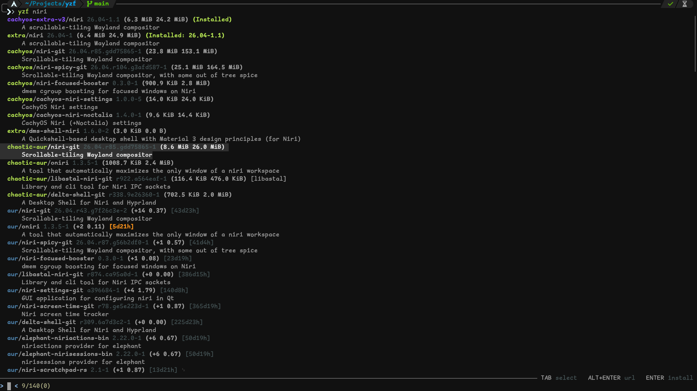
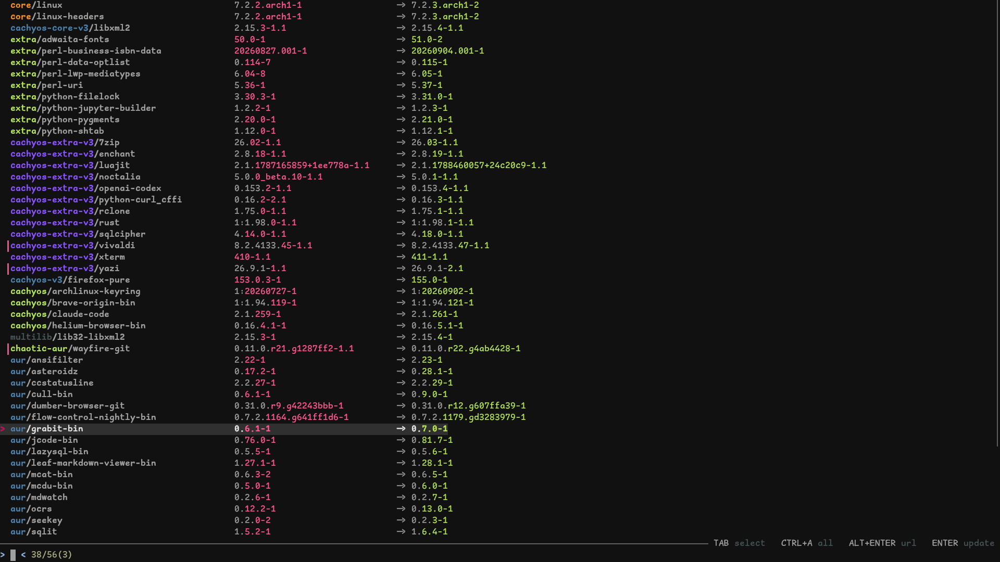
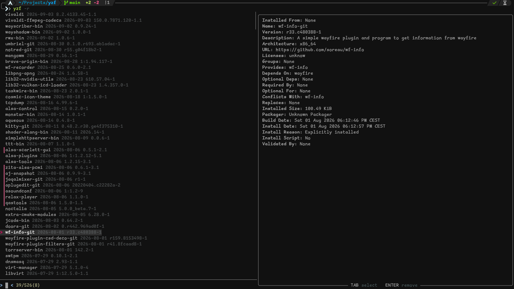

An [fzf](https://github.com/junegunn/fzf) wrapper around [yay](https://github.com/Jguer/yay).

## Usage

```
yzf <query>   Search and install packages
yzf u         Upgrade upgradable packages
yzf r         Remove recently installed packages
yzf o         Remove orphan packages
yzf h         Help
```

Every option also accepts a dash (`yzf -u`, `yzf -r`, `yzf -o`, `yzf --help`).

## Search & install



Runs the search and shows the results in fzf, in yay's own ordering and coloring - official repos first, AUR last, with descriptions, sizes, vote counts and (Installed) markers left intact.

## Upgrade



Lists everything that has an update available for both repo packages and AUR packages exactly like running just `yay` with no arguments does. Nothing is upgraded unless you pick it and nothing is selected by default.

## Remove recently installed packages



Most of the time you want to remove something, it is because you just installed it, tried it, and did not like it. This mode lists your explicitly installed packages ordered by install date, newest first. It is not limited to the last few days, though: the list covers *all* explicitly installed packages, so it works as a general "remove any package I installed" list. Removal runs `sudo pacman -Rnsc` on the selection, so the package's unneeded dependencies as well as anything that depends on the package is removed.

## Remove orphans

Lists orphans - packages that were pulled in as dependencies and are no longer required by anything and removes the selection.

## Requirements

- yay, pacman, expac, checkupdates
- fzf ≥ 0.60
- GNU awk
- xdg-open

## Customizing the look

By default yzf uses its own fzf layout and **ignores your global `FZF_DEFAULT_OPTS`** but you can use these environment variables to change things:

**`YZF_DEFAULT_OPTS`** - extra fzf options, applied last, so they override yzf's own. Use this to apply specific overrides:

```sh
export YZF_DEFAULT_OPTS="--color=fg:#c0caf5,bg:-1,hl:#bb9af7 --border=rounded --preview-window=right:60%"
```

**`YZF_USE_DEFAULT=1`** - respect `FZF_DEFAULT_OPTS` and apply a global fzf config on top of yzf's defaults:

```sh
YZF_USE_DEFAULT=1 yzf u
```

The precedence is: yzf's built-in options → `FZF_DEFAULT_OPTS` (only when `YZF_USE_DEFAULT=1`) → `YZF_DEFAULT_OPTS`. Later wins.
